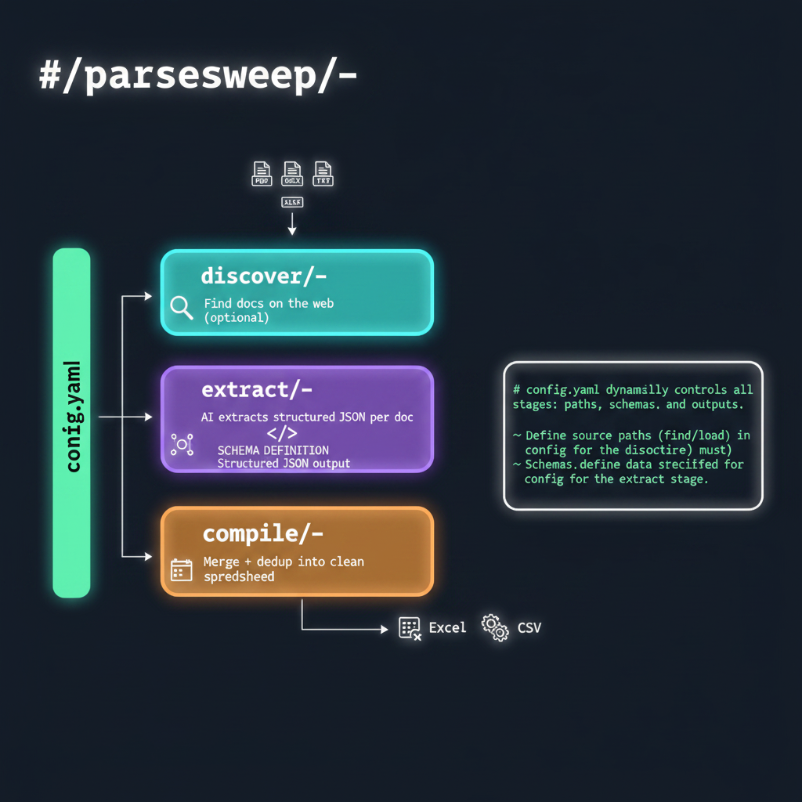

# ParseSweep

[](https://opensource.org/licenses/MIT)
[](https://www.python.org/downloads/)
[](https://github.com/bpulluta/parsesweep/actions/workflows/ci.yml)
[](https://bpulluta.github.io/parsesweep/)

📖 **[Documentation](https://bpulluta.github.io/parsesweep/)** · [Getting Started](https://bpulluta.github.io/parsesweep/getting-started.html) · [Tuning & Iteration](https://bpulluta.github.io/parsesweep/tuning.html)

**AI-powered document extraction pipeline.**

ParseSweep discovers documents, extracts schema-defined data, and compiles records into Excel/CSV. Start discovery with a small YAML config; add your own JSON schema and LLM credentials when you need extraction. Inspect acquired documents and extracted records before using the results.



## What It Does

```
Documents (PDF, DOCX, TXT, XLSX)
        │
        ▼
┌─── discover ───┐    ┌─── extract ───┐    ┌─── compile ───┐
│ Find docs on   │ →  │ AI extracts   │ →  │ Merge + dedup │ → Excel/CSV
│ the web        │    │ structured    │    │ into clean    │
│ (optional)     │    │ JSON per doc  │    │ spreadsheet   │
└────────────────┘    └───────────────┘    └───────────────┘
```

Each step runs independently via the same config file.

---

## Quick Start — Discovery First

```bash
# Install
curl -fsSL https://pixi.sh/install.sh | bash
git clone https://github.com/bpulluta/parsesweep.git && cd parsesweep
pixi install

# Create your domain config
mkdir -p config/my_domain
cp config/TEMPLATE.yaml config/my_domain/run.yaml
```

Set `SERPAPI_API_KEY=your-serpapi-key` in your environment or `.env`, not YAML.
Edit the copied config's domain and query. Its active content can be just:

```yaml
domain: my_domain
discovery:
  queries:
    - "industrial pump installation manual filetype:pdf"
```

No extraction schema or LLM credential is needed for discovery alone. Queries
auto-enable SerpApi when search is omitted; explicit `search.enabled: false`
wins. For known document URLs, replace `queries`
with `seeds`; seed-only input does not auto-enable search.

```bash
# Local input-plan validation: no network calls or run artifacts
pixi run psweep discover --config config/my_domain/run.yaml --validate-config
pixi run psweep discover --config config/my_domain/run.yaml
```

Inspect the selected files in `discovered/my_domain/runs/<run_id>/curated` and
the consolidated `discovered/my_domain/curated`. Defaults are **10 unique
candidates per query**, **1 acquisition per target**, direct acquisition/no
crawl, concurrency **2**, retry attempts **3**, and robots/ToS policy **warn**.
Search cache and browser recovery are **off**. No LLM review is automatic.
A capped search or successful validation does not establish recall, correct
semantics, working credentials, or live provider/network availability.

See [Getting Started](docs/getting-started.md) for the discovery-to-extraction
workflow, [config/TEMPLATE.yaml](config/TEMPLATE.yaml) for common optional
choices, and [config/ADVANCED.yaml](config/ADVANCED.yaml) for expanded stages.

---

## Architecture

### Two Files Per Domain — When Extracting

| File | Role |
|------|------|
| **Schema** (JSON) | Defines WHAT to extract — field names, types, descriptions |
| **Config** (YAML) | Defines HOW to run — discovery inputs, paths, models, output format |

Discovery uses the config alone. Add your own schema and LLM credentials when
you are ready to extract; schemas under `schemas/personal/` are local inputs,
not a prerequisite or published private schema set.

### Config Is the Single Entry Point

Every command accepts `--config`. All supplied sections are validated at load;
each command executes only its own section. Only the explicitly selected file
is loaded. Adjacent `discovery`, `extraction`, `compilation`, or `validation`
YAML/JSON overrides beside a `run` config are retired: move their sections into
that file and remove the adjacent files. Add extraction and compilation later
to the same config:

```yaml
extraction:
  schema: schemas/personal/my_schema.json
  input_dir: discovered/my_domain/curated   # or documents/my_domain for local files
  output_dir: extracted/my_domain
  model: your-model-name
compilation:
  schema: schemas/personal/my_schema.json
  input_dir: extracted/my_domain
  output_dir: compiled/my_domain
  # Dedup identity is schema-owned ($metadata.identity.deduplication.key_fields)
```

Run stages independently or chain the configured stages:

```bash
pixi run psweep discover --config config/my_domain/run.yaml
pixi run psweep extract  --config config/my_domain/run.yaml
pixi run psweep compile  --config config/my_domain/run.yaml

# Full pipeline, once its sections are configured
pixi run psweep run --config config/my_domain/run.yaml
```

---

## Commands

| Command | Purpose |
|---------|---------|
| `run` | Run full pipeline (discover → extract → compile) from a config file |
| `extract` | Extract structured data from documents to JSON |
| `compile` | Merge extracted JSONs into Excel/CSV with deduplication |
| `discover` | Find and download documents from the web |
| `curate` | Filter discovered documents via review |
| `validate` | Run QA/QC validation (multi-model extract + report, or report-only) |
| `benchmark` | Performance profiling across runs |
| `check` | Validate an extraction result |
| `check-schema` | Validate a schema file |
| `init` | Interactive project setup |
| `init-domain-schema` | Create a starter schema for a new domain |
| `preview` | Preview document content |
| `estimate` | Estimate extraction cost/time |
| `config` | Show current configuration |

### Extract

```bash
pixi run psweep extract --config config/my_domain/run.yaml

# Options
  --config PATH       Config YAML (required for full features)
  --schema PATH       Schema-only mode (quick testing without a config file)
  -n N                Limit to N files
  --fresh             Re-extract existing files (ignore cached output)
  --live-dashboard    Real-time progress display
  --validate-config   Dry run — validate inputs only
```

### Compile

```bash
pixi run psweep compile --config config/my_domain/run.yaml

# Options
  --config PATH       Config YAML
  --schema PATH       Schema-only mode
  --dry-run           Preview deduplication without writing
  --validate-config   Dry run — validate inputs only
```

### Curate

```bash
pixi run psweep curate --config config/my_domain/run.yaml
pixi run psweep curate --run discovered/my_domain/latest

# Options
  --config PATH       Config YAML or domain run config
  --run PATH          Specific run directory
  --quiet             Minimal output
  --verbose           Detailed output
```

### Discover

```bash
pixi run psweep discover --config config/my_domain/run.yaml

# Options
  --config PATH                 Config YAML
  --validate-config             Validate local input plan; no network calls/output writes
  --dry-run                     Show acquisition plan; search may still contact the provider
  --max-concurrent-downloads N   Limit parallel downloads (default: 2)
```

Discovery exits **0** for `success`, `dry_run`, or validated `reused` work,
**1** for failed or partially failed acquisition (including zero downloads due
to failure), and **2** for a genuinely empty result. Quiet/default/verbose modes
use the same outcome and exit code; a partial manifest is not success.

### Discovery Configuration — Add as Needed

The quick start does not need `targets.csv`. For multiple targets, each CSV row
supplies query-template fields and context for optional document review:

```csv
label,jurisdiction,state,topic,technology
"Chaffee County CO","Chaffee County",Colorado,geothermal ordinance,geothermal electricity
"Imperial County CA","Imperial County",California,geothermal ordinance,geothermal electricity
```

```yaml
discovery:
  targets_csv: targets.csv
  queries:
    - "{jurisdiction} {state} ordinance filetype:pdf"
  search:
    max_results: 10               # unique candidates PER QUERY, not downloads
    cache: false                  # default: off; cache hits make zero live search calls
  selection:
    max_per_target: 1             # default acquisition count per target
    exclude: [press release, fact sheet, presentation]
  partition_by: [state, jurisdiction]

  # Optional keyword check after acquisition (no LLM calls):
  # document_classifier:
  #   required_keywords: [ordinance, code, chapter, section]
  #   min_required_matches: 2
  #   action: warn

  # Optional PAID LLM curation — explicitly opt in and configure credentials:
  # document_review:
  #   model: your-model-name
  #   document_description: "enacted regulation text, not a draft or summary"
  #   keep_top: 1                  # review retention, not acquisition count
```

The local candidate cap covers live/cached results and enabled news results;
provider `num` is not trusted as the cap. No hidden pagination or refill is
performed. `max_per_target` controls acquisition, while optional LLM review's
`keep_top` controls retention after acquisition. No LLM review is auto-enabled.

For strict source scope, combine `allowed_domains` and URL-path regexes:

```yaml
discovery:
  allowed_domains: [example.org]
  discovery_rules:
    include_url_patterns: ['^https?://(?:www\.)?example\.org/documents/']
```

Scope is enforced before top-one selection and on final redirects. Provider
`site:`/`filetype:` query hints are not guarantees. Concrete provider/vendor
source filters belong in the domain config; a document parser does not add them
automatically. `selection.exclude_url_patterns` uses case-insensitive regexes
on URLs; `relevance_allowed_domain_patterns` is only a ranking boost, not a
host allowlist.

Use canonical `search`, `search.max_results`, and selection
`max_per_target`/`require_any`/`exclude`. Retired `seeker`,
`max_results_per_query`, `primary_per_target`, `relevance_require_any_terms`, and
`relevance_exclude_any_terms` fail with actionable migration errors, even when
canonical keys coexist. There are no built-in legal draft, vendor authority,
or shopping-path policies: configure `draft_patterns`, `domain_scores`, and
`shopping_path_keywords` for your domain. Supply `jurisdiction` and `state`
explicitly or use `partition_by`; query text does not infer geography and there
is no built-in US discovery alias table.

PDF candidates are preferred to web pages when present. HTML/HTM and
extensionless HTTP(S) URLs are provisionally eligible without setting
`require_supported_document: false`; known non-document binaries are excluded,
and GET/MIME checks verify ambiguous candidates. Inspect document relevance
before downstream use.

Browser mode is off. Browser escalation and code-host adapters are also off
until explicitly configured with `browser_escalation: {enabled: true}` or
`code_host_adapters: {enabled: true}`. Threshold-only blocks do not enable either.
Strict robots/ToS enforcement cannot certify browser redirects or subresources;
it fails before unsupported browser navigation. Use HTTP acquisition for
enforcement. SerpApi/download TLS verification defaults remain `false`; choose verification
with environment options `SERPAPI_SSL_VERIFY`, `DISCOVERY_SSL_VERIFY`, and a
Requests CA bundle with `REQUESTS_CA_BUNDLE` if applicable.

See [config/ADVANCED.yaml](config/ADVANCED.yaml) and the
[configuration reference](docs/config-reference.md) for expanded settings.

---

## Add Extraction to a New Domain

Start with discovery above, or skip it if your documents are already local.
Extraction and compilation need a schema plus LLM credentials for extraction.
Run `pixi run psweep init` for credential setup, or configure `.env` manually.

### 1. Create Schema

The existing scaffold is **schema-specific**, not a discovery setup wizard:

```bash
pixi run psweep init-domain-schema --name my_domain \
  --reference-schema schemas/example_utility_rate_schema.json
```

Or create manually — a minimal schema:

```json
{
  "$schema": "http://json-schema.org/draft-07/schema#",
  "$metadata": {
    "extraction": {
      "main_data_array": "items",
      "identifier_fields": ["metadata.name"],
      "context_objects": ["metadata"]
    }
  },
  "type": "object",
  "properties": {
    "metadata": {
      "type": "object",
      "properties": {
        "name": { "type": "string", "description": "Document name" }
      }
    },
    "items": {
      "type": "array",
      "items": {
        "type": "object",
        "properties": {
          "field1": { "type": "string", "description": "First field" },
          "field2": { "type": ["number", "null"], "description": "Second field" }
        }
      }
    }
  }
}
```

Save it to `schemas/personal/my_schema.json`. The `schemas/personal/` directory is the recommended location for your project-specific schemas.

### 2. Add Sections to Your Config

If you started with `config/TEMPLATE.yaml`, add extraction and compilation to
the same config; its commented blocks show the minimal paths. For a local-only
workflow, you can instead create a config containing only these sections:

```yaml
domain: my_domain

extraction:
  schema: schemas/personal/my_schema.json
  input_dir: documents/my_domain       # or discovered/my_domain/curated
  output_dir: extracted/my_domain
  model: your-model-name

compilation:
  schema: schemas/personal/my_schema.json
  input_dir: extracted/my_domain
  output_dir: compiled/my_domain
  # Dedup identity is schema-owned ($metadata.identity.deduplication.key_fields)
```

Use [config/ADVANCED.yaml](config/ADVANCED.yaml) for additional model aliases,
page targeting, output shaping, synthesis, or QA/QC. These are existing optional
settings, not requirements for discovery.

### 3. Extract and Compile

```bash
# Put test documents in documents/my_domain/

# Schema-only quick test (no config needed, good for iteration)
pixi run psweep extract documents/my_domain/ \
  --schema schemas/personal/my_schema.json -n 2

# Full run via config (recommended — picks up all settings)
pixi run psweep extract --config config/my_domain/run.yaml
pixi run psweep compile --config config/my_domain/run.yaml
```

Output fields come from each domain's schema. For configurable column shaping,
validation, and scale limits, see the
[compilation reference](docs/config-reference.md#schema-driven-compilation).

---

## Large Documents

For documents over 200 pages, configure **page targeting** to automatically find relevant sections:

```yaml
extraction:
  schema: schemas/personal/my_schema.json
  pages:
    csv: config/domain/page_ranges.csv   # manual ranges (win over auto)
    auto_locate:                          # LLM fallback for uncovered docs
      section_description: "the section containing rate schedules"
      trigger_chars: 200000              # only for docs exceeding this size
      max_selected_pages: 30
```

- Use `pages.csv` alone for fully manual ranges
- Use `pages.auto_locate` alone for fully automatic targeting
- Use both: CSV entries win, auto-locate fills in uncovered large docs
- `--pages 615-759` — CLI override for a single file
- `max_context: 1400000` — brute force (expensive)

---

## QA/QC Multi-Model Validation

Run 2+ models on the same documents using the centralized run config:

```bash
pixi run psweep validate --config config/my_domain/run.yaml

# Rebuild reports later without re-running extraction
pixi run psweep validate --config config/my_domain/run.yaml --compare-only
```

Configure in the `validation:` section of your config:

```yaml
validation:
  models: [primary, secondary]
  report:
    include_missing_in_queue: true
    include_low_signal_presence_in_queue: false
  comparison_approach: mixed
  record_matching:
    key_fields: [field1, field2]
  comparison:
    primary_fields: [value, unit]
  judge:
    enabled: true
    model: judge
```

---

## Multi-Source Synthesis

When extracting from many documents about the same entities (news articles, filings, reports for the same set of companies or sites), the **synthesis** stage reconciles multiple per-document records into one authoritative row per entity — resolving conflicts, tracking confidence, and collecting citation URLs.

Configure in the `compilation.synthesis:` block:

```yaml
compilation:
  schema: schemas/personal/my_schema.json
  input_dir: extracted/my_domain
  output_dir: compiled/my_domain
  synthesis:
    enabled: true
    min_sources_for_llm: 2          # skip LLM call when only 1 source
    group_by: ["entity.name"]       # one output row per distinct entity
    identity_fields:
      - entity.category
      - entity.location
    citation_field: source_provenance.citation_url
    reconcile_fields:
      - {field: status}
      - {field: date_announced, evidence: evidence_announced}
      - {field: value, evidence: value_evidence}
```

Synthesis runs automatically on `compile` when enabled. It uses the same LLM configured in your environment (override with `synthesis.model:` for a specific stage).

### Keeping repeated sub-entities apart

By default every item found in the extracted array is folded into one row per entity. When a record repeats sub-entities (phases, expansions, line items, permit conditions...), add `item_group_by` — item-level field paths — to synthesize one row per sub-entity instead:

```yaml
  synthesis:
    enabled: true
    group_by: ["entity.name"]       # one output row per distinct entity ...
    item_group_by: ["phase_label"]  # ... per distinct sub-entity within it
```

Items are bucketed by that key across *all* sources for the entity, so the same phase reported by three documents is still reconciled once. Items missing the key are kept in their own row rather than dropped, and the item-group fields appear as columns alongside `group_by` and `identity_fields`. Leaf names must not collide with `group_by` leaf names — that is rejected at config load.

---

## Project Structure

```
parsesweep/
├── config/                    # Domain configs (one per domain)
│   ├── TEMPLATE.yaml          # Short discovery-only starting point
│   ├── ADVANCED.yaml          # Expanded stage examples and annotations
│   └── my_domain/             # Create locally
│       ├── run.yaml
│       └── page_ranges.csv    # optional manual extraction page ranges
├── schemas/
│   ├── personal/              # Local project-specific schemas (JSON)
│   └── example_utility_rate_schema.json
├── documents/                 # Input documents (created by you)
├── extracted/                 # JSON extraction output (generated)
├── compiled/                  # Final Excel/CSV output (generated)
├── discovered/                # Web discovery output (generated by discover)
└── src/psweep/                # Source code
    ├── cli/                   # CLI commands
    ├── discovery/             # Web document discovery
    ├── extraction/            # Document extraction
    ├── compilation/           # Data compilation + synthesis
    ├── validation/            # QA/QC multi-model comparison
    └── utils/                 # Shared utilities
```

---

## Configuration Reference

Use [config/TEMPLATE.yaml](config/TEMPLATE.yaml) for the short discovery-only
start, and [config/ADVANCED.yaml](config/ADVANCED.yaml) for expanded stage
examples and annotations. The [configuration reference](docs/config-reference.md)
renders both templates and documents defaults, validation, and limitations.

### Config Sections

| Section | Used By | Required |
|---------|---------|----------|
| `discovery:` | `discover` | For web acquisition; no extraction schema required |
| `extraction:` | `extract` | Needs `schema` and `input_dir` (or CLI input) |
| `compilation:` | `compile` | Needs `schema` and input records |
| `validation:` | `validate` | QA/QC validation stage |
| `domain:` | All | Names the domain/output namespace |
| `models:` | Configured LLM stages | Optional aliases; does not auto-enable review |

### Key Extraction Settings

```yaml
extraction:
  schema: path/to/schema.json      # required
  input_dir: path/to/documents     # required (or pass as CLI argument)
  output_dir: extracted/domain     # default: extracted/<domain>
  max_context: 600000              # chars per document
  pages:                           # page selection for large PDFs
    csv: path/to/ranges.csv        # manual ranges (win over auto)
    auto_locate:                   # LLM fallback for uncovered docs
      section_description: "..."
      trigger_chars: 200000
      max_selected_pages: 30
```

### Key Compilation Settings

```yaml
compilation:
  schema: path/to/schema.json      # required
  input_dir: extracted/domain      # required (or pass as CLI argument)
  output_dir: compiled/domain      # default: compiled/<domain>
  # Dedup identity is schema-owned — set $metadata.identity.deduplication
  # .key_fields in the schema, not here (used by extract/compile/api alike).
  normalization:
    state_column: State            # auto-abbreviate state names
  output:
    default_format: excel          # excel, csv, or both
    column_order: [f1, f2, ...]    # custom column ordering
    column_renames: {Old: new}     # rename columns
    exclude_fields: [internal_f]   # hide columns
    freeze_columns: 2              # freeze in Excel
    auto_width: true               # auto-size columns
  synthesis:                       # optional — multi-source reconciliation
    enabled: true
    group_by: ["entity.key_field"]
    reconcile_fields:
      - {field: some_field}
```

### Model Overrides (Optional)

```yaml
# ── Model tiers ──────────────────────────────────────────────────────────────
# Define model identifiers ONCE. Each pipeline stage references a tier name
# (primary/secondary) — never a raw model string — so you can swap models
# globally by editing only these two lines.
#
#   primary   → used for extraction (accuracy-critical)
#   secondary → used for discovery review, page targeting (speed/cost-critical)
#
# For iteration/testing: set both to mini. For production: use full-size primary.
models:
  primary: gpt-4.1                 # swap to gpt-4.1-mini for fast iteration
  secondary: gpt-4.1-mini          # cheap/fast for non-extraction stages

# Stages reference tier names:
extraction:
  model: primary                   # ← resolves to gpt-4.1

discovery:
  document_review:
    model: secondary               # ← resolves to gpt-4.1-mini
```

When using an endpoint override (`LLM_BASE_URL`), use whatever model names the proxy advertises:

```yaml
# Proxy model names — exactly as shown in the proxy's model hub
models:
  primary: gpt-5.5
  secondary: gpt-5-mini
  # The proxy handles routing to the actual provider — no provider config needed
```

**Workflow:**
- Testing/iterating: set both tiers to `mini` (fast + cheap)
- Production: change only `primary` to the full model (one edit)
- Stage-level granularity available if needed
- To switch between proxy and direct provider: change `.env`, not the YAML

---

## Cost Visibility & Accounting

ParseSweep tracks costs at every stage and surfaces them to the user.

### Before a Run

```bash
# Validate config without any API calls
pixi run psweep extract --config config/my_domain/run.yaml --validate-config

# Estimate cost before committing
pixi run psweep estimate discovered/my_domain/latest/curated

# Discovery dry-run (no downloads or LLM calls)
pixi run psweep discover --config config/my_domain/run.yaml --dry-run
```

### During a Run

Extraction shows per-file cost in real-time:
```
✓ 42 items $0.0121 • 75.3s
```

### After a Run

**Extraction summary** with total/average cost:
```
╭─── Extraction Summary ───╮
│ Total Cost    $0.0389     │
│ Avg Cost/File $0.0195     │
│ Total Items   99          │
╰───────────────────────────╯
```

**Pipeline accounting** — written on compile to `compiled/{domain}/run_accounting.json`:
```json
{
  "stages": {
    "discovery": { "seeker_queries": 2, "review_cost_usd": 0.011, ... },
    "extraction": { "model": "gpt-4.1-mini", "cost_usd": 0.021, "input_tokens": 42498, ... },
    "compilation": { "records": 67, "duplicates_removed": 1 }
  },
  "totals": { "cost_usd": 0.032, "elapsed_seconds": 275.9, "llm_calls": 15, "tokens": 77230 }
}
```

### Caching & Re-runs

Discovery checkpoint **v2** reuse requires the same effective config and valid
artifact digest evidence (including curated files). Changed settings, missing
or altered artifacts, and old v1 entries cause reacquisition, not a success
skip. Discovery publication locks reject concurrent corpus writers; its journal
recovers interrupted curated/provenance swaps on the next writer. This is a
small discovery-specific protocol, not a general pipeline transaction.
Extraction skips existing JSON outputs by default.
**Search-result caching is separate and off by default.**
Opt in with `discovery.search.cache: true`; a cache hit makes zero live search
calls. Checkpoint skips and cache hits are not the same mechanism.

```bash
# Resume/skip previous completed work
pixi run psweep discover --config config/my_domain/run.yaml
pixi run psweep extract  --config config/my_domain/run.yaml

# Re-run discovery; bypass checkpoint and any enabled search cache
pixi run psweep discover --config config/my_domain/run.yaml --fresh

# Force re-extract (no need to delete files)
pixi run psweep extract --config config/my_domain/run.yaml --fresh

# Whole pipeline fresh — propagates --fresh to discover and extract
pixi run psweep run --config config/my_domain/run.yaml --fresh
```

`compile` always rewrites its output, so it needs no flag.

**What `--fresh` changes, per stage:**

| Stage | `--fresh` action |
| --- | --- |
| `discover` | Clears the crash-resume checkpoint (`discovered/<domain>/checkpoint.json`) and bypasses enabled SerpApi cache entries for fresh queries. It does not enable caching or search. |
| `extract` | Re-extracts every document even if a JSON output already exists. |
| `compile` | No flag — output is always rewritten. |

**Document sidecars:** OCR text uses `.text/<filename>.txt` and
`.text/<filename>.meta.json` (for example, `report.pdf.txt`), preserving format
identity. Source size/mtime and SHA-256 plus the cached-text SHA-256 must match;
partial or mismatched pairs are cache misses. Writes replace temporary files
with metadata last; old stem-only caches are not reused. LLM review sidecars
use `.review/<filename>.json`. Selected documents carry these sidecars into
curated output. Native extraction, OCR correction rules, and page-targeting
(`.pages/`) behavior are unchanged by this naming migration. These caches are
separate from opt-in search caching; delete `.text/` or `.pages/` to request
cold OCR or page targeting.

---

## Supported Formats

PDF, DOCX, DOC, TXT, XLSX, CSV

---

## Environment Setup

ParseSweep reads credentials from a `.env` file in the project root (or from environment variables). Configure exactly one provider block. Priority is highest → lowest.

### Option 1 — Generic endpoint override (recommended for shared/enterprise deployments)

Works with any OpenAI-compatible proxy: LiteLLM, OpenRouter, Azure AI Foundry, Together AI, vLLM, Ollama, etc. Model names in `run.yaml` must match exactly what the proxy advertises. To switch proxies, change two values — no code or schema changes needed.

```bash
LLM_BASE_URL=https://your-proxy.example.com/v1
LLM_API_KEY=sk-your-proxy-key
LLM_MODEL=gpt-4.1-mini     # optional default; overridden by run.yaml models:
```

```yaml
# run.yaml — use whatever model names your proxy advertises
models:
  primary: gpt-5.5
  secondary: gpt-5-mini
  # or mix providers served by the same proxy:
  # fast: claude-sonnet-4-5
  # smart: gpt-5.5
```

### Option 2 — Direct provider keys

```bash
# Azure OpenAI
AZURE_OPENAI_API_KEY=your-key
AZURE_OPENAI_ENDPOINT=https://your-resource.openai.azure.com/
AZURE_OPENAI_API_VERSION=2025-04-01-preview
AZURE_OPENAI_MODEL=your-deployment-name   # optional default

# OpenAI
OPENAI_API_KEY=sk-your-key

# Anthropic
ANTHROPIC_API_KEY=sk-ant-your-key

# Google Gemini
GEMINI_API_KEY=your-google-key
```

Copy `.env.example` to `.env` and uncomment one block. Run `psweep init` for interactive setup.

---

## Troubleshooting

**"No documents found"** — Check file extensions are supported and path exists.

**"Schema missing $metadata"** — Schema needs `$metadata.extraction.main_data_array` and `identifier_fields`.

**Large document timeout** — Add `pages.auto_locate` in your config or increase `max_context`.

**Rate limit errors** — API throttling (429). Wait and retry, or reduce batch size with `-n`. For proxy deployments, exponential backoff is built in.

**"No LLM provider configured"** — Check `.env` has one of: `LLM_BASE_URL`+`LLM_API_KEY`, `AZURE_OPENAI_API_KEY`, `ANTHROPIC_API_KEY`, `GEMINI_API_KEY`, or `OPENAI_API_KEY`.

**Wrong model name for proxy** — Model names must match exactly what your proxy's model hub shows. Run `psweep config` to confirm the resolved model.

---

## Development

```bash
pixi run python -m pytest tests/   # run tests
pixi run psweep check-schema schemas/personal/my_schema.json  # validate schema
pixi run psweep extract --config ... --validate-config  # dry-run validation
```

---

## License

MIT License. See [LICENSE](LICENSE).
